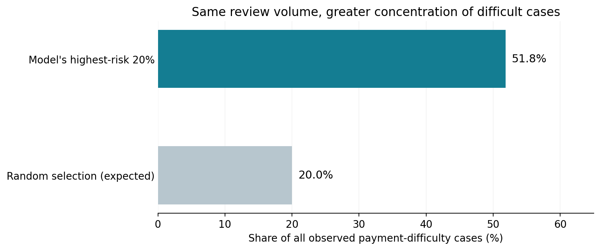

# Home Credit: Predicting Repayment Difficulty

**Dahyun Kim | Individual analytics portfolio | Python, pandas, scikit-learn, SHAP**

How can a lender identify repayment risk while preserving access to credit? I completed this capstone individually with AI assistance, exploring Home Credit application data, building reproducible models, and translating their results into business trade-offs. The retained gradient-boosting model achieved **0.7573 mean cross-validation ROC-AUC** and a recorded **0.74479 Kaggle private ROC-AUC**. Its strongest contribution is risk ranking; using it for lending decisions would require further validation.

**Start here:** [Individual project walkthrough](notebooks/00_individual_portfolio.ipynb) explains the findings, decisions, and lessons. It includes saved results and runs without downloading the raw data.

## Business problem and objective

Applicants with limited conventional credit histories can be difficult to assess. Home Credit needs to distinguish applicants likely to experience repayment difficulty from those likely to repay, balancing credit risk with access to lending. My objective was to build and evaluate a model that ranks this risk and explain what the results could mean for credit-risk stakeholders.

The labeled dataset contains **307,511 applications**, including **24,825 payment-difficulty cases (8.07%)**; the competition test set contains **48,744 applications**. The target is Kaggle's payment-difficulty label, which is not a direct measure of charge-offs or financial loss.

## My solution

I examined missing values, unusual codes, affordability measures, and applicant characteristics, then developed an application-level pipeline with missingness flags, documented data-quality treatments, and derived age, employment, and credit-to-income features. Learned preparation, imputation, and encoding stay inside each cross-validation training fold to prevent validation information from entering model fitting. Application IDs are excluded from predictors.

I compared simple baselines with random forest and histogram gradient boosting on the same three stratified folds. ROC-AUC guided selection because predicting no difficulty for everyone already achieves 91.93% accuracy.

| Model | Mean CV ROC-AUC |
| --- | ---: |
| Majority-class baseline | 0.5000 |
| Logistic regression, unweighted | 0.7498 |
| Logistic regression, balanced | 0.7500 |
| Random forest, balanced subsample | 0.7312 |
| **Retained histogram gradient boosting** | **0.7573** |
| Sample-tuned histogram gradient boosting | 0.7579 |

Tuning improved mean AUC by only **0.000638**, below the predefined **0.001** retention threshold, so I retained the default configuration. The [modeling notebook](notebooks/02_modeling.ipynb) documents the experiments; the [model card](notebooks/04_model_card.ipynb) covers explanations, threshold sensitivity, and simulated subgroup outcomes.

## Business value

In the historical out-of-fold predictions, the **20% of loans with the highest predicted risk contained 51.8% of observed payment-difficulty cases**. This concentration suggests a way to investigate prioritizing limited review capacity.

About **79.1% of loans in that high-risk group did not have the recorded difficulty**, so automatically rejecting the entire group would create many false alarms. These historical results do not measure savings or cases prevented. Actual financial value requires current-policy comparisons, verified loss and revenue data, and review costs. The [walkthrough](notebooks/00_individual_portfolio.ipynb) shows the calculation and its limits.

## Difficulties and decisions

- **Messy data:** Missing values and the `DAYS_EMPLOYED = 365243` sentinel required explicit treatments. I preserved raw files and used reversible flags and derived features.
- **Imbalanced outcomes:** High accuracy concealed poor detection. I compared ranking performance and examined threshold trade-offs.
- **Optimistic development results:** Kaggle private AUC was about 0.0125 below local mean CV AUC. I report both; the development folds are not a new untouched evaluation.
- **Limited feature provenance:** Supplementary histories and opaque external scores raised timing and interpretation questions. The implemented model uses application-table features; broader historical joins remain deferred.
- **Responsible interpretation:** Gender and other sensitive or proxy information affect the model. The model card reports descriptive subgroup differences and explains why these results do not establish fairness or production readiness.

## What I learned

The project taught me to connect each data treatment to evidence, fit learned transformations at the correct validation scope, and distinguish a small metric gain from a useful model change. I also learned that a ranking score, a decision threshold, and business value answer different questions. Explaining false alarms, uncertainty, and missing financial inputs is as necessary as reporting AUC.

## Explore the work

| Notebook | What it demonstrates |
| --- | --- |
| [Individual portfolio walkthrough](notebooks/00_individual_portfolio.ipynb) | Personal synthesis, reproducible aggregate calculations, and lessons; no raw data required. |
| [Working EDA](notebooks/01_eda.ipynb) | Detailed investigation, data-quality checks, and preparation decisions. |
| [Model experiments](notebooks/02_modeling.ipynb) | Baselines, fold-local preprocessing, tuning, and recorded Kaggle results. |
| [Model-card calculations](notebooks/03_model_card_analysis.ipynb) | Technical source for threshold, SHAP, and subgroup analysis; local artifacts required to rerun. |
| [Stakeholder model card](notebooks/04_model_card.ipynb) | Business interpretation with embedded figures that can be viewed without local files. |

The individual walkthrough is a separate portfolio narrative. Earlier submission notebooks remain as supporting project records. Reusable implementation is in [`src/`](src/); [reproduction instructions](REPRODUCING.md) explain the data, environment, and execution order.

## AI assistance and data

I used AI assistance throughout the project, including code development, analysis organization, explanations, and writing. This portfolio represents my individual AI-assisted workflow. Reported metrics are tied to executed project artifacts; the walkthrough identifies its aggregate sources and does not present those calculations as a new model evaluation.

Data come from [Kaggle's Home Credit Default Risk competition](https://www.kaggle.com/competitions/home-credit-default-risk/data). Download and use them under the competition's terms. Raw data, row-level predictions, fitted models, credentials, and local environments are excluded from this portfolio update.
